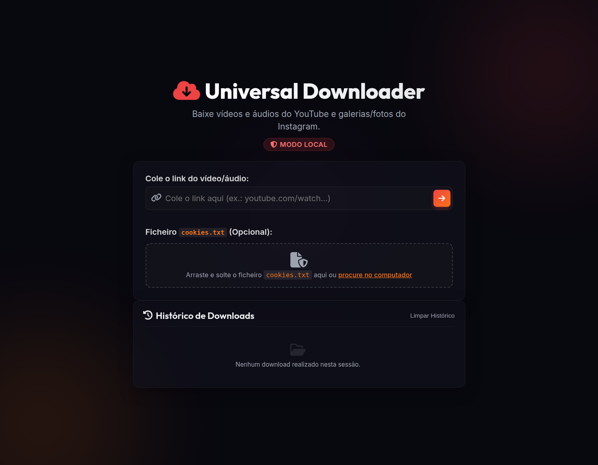

# UniversalDownloader

> Self-hosted video and audio downloader for Apache + PHP (XAMPP). Paste a public URL, pick **MP4** or **MP3**, download. Playlists come back as a ZIP.

Built on [yt-dlp](https://github.com/yt-dlp/yt-dlp) and [FFmpeg](https://ffmpeg.org/). No Python, Flask, virtualenv or background server: just Apache and PHP.

## Demo

## Features

- **Metadata preview**: title, thumbnail, duration, author and available qualities before downloading.
- **MP4 or MP3**: MP4 prefers H.264 + AAC for compatibility with common Windows players; MP3 is encoded at 320 kbps.
- **Quality selection**: best available or capped at a chosen resolution.
- **Playlists and channels**: choose first item, limit and order; multiple files are delivered as a ZIP (up to 500 items per request).
- **Real file names**: files are saved with the video title, never a generic `video.mp4`.
- **Optional `cookies.txt`**: use cookies exported from your own session when a site requires login.
- **Local history** kept only in your browser (`localStorage`), clearable with one click.
- **Brave/Chromium extension** included in `UniversalDownloader-Brave-Extension/`.
- **Safe by default**: only public HTTP/HTTPS URLs; `localhost`, `.local` and private/reserved IPs are rejected; commands are built with individually escaped arguments; temporary files are deleted after each response.

## Quick start (Windows + XAMPP)

1. Copy the project folder to `C:\xampp\htdocs\UniversalDownloader\`.
2. Check that `tools\yt-dlp.exe` and `tools\ffmpeg.exe` exist (see [Components](#components)).
3. In `C:\xampp\php\php.ini`, enable `extension=zip` and make sure `proc_open`, `proc_close`, `proc_get_status` and `proc_terminate` are **not** in `disable_functions`.
4. Start (or restart) Apache from the XAMPP control panel. MySQL is not needed.
5. Open `http://localhost/UniversalDownloader/`.

`instalar.bat` is included to help with the initial setup.

## Usage

Paste a public URL and press the arrow to fetch metadata. Choose **Video (MP4)** or **Audio (MP3)**, pick a quality, and start the download.

| Option | Result |
|---|---|
| Video + best quality | Best video + audio combination, delivered as MP4 when possible |
| Video + resolution | Best video up to the chosen resolution, with audio |
| Audio | Best audio converted to MP3 (320 kbps) |
| Playlist / channel | Set first item, limit and order; several files are returned as a ZIP |
| `cookies.txt` | Optional; only use cookies from your own session |

## Components

| Component | Role |
|---|---|
| `index.php` | Web interface |
| `api/info.php` | Fetches title, duration, thumbnail and qualities |
| `api/download.php` | Starts the download and streams the result |
| `lib/YtDlpService.php` | Validation, yt-dlp execution, playlists, ZIP and cleanup |
| `tools/yt-dlp.exe` | Extractor for the supported sites |
| `tools/ffmpeg.exe` | Merges video/audio and converts to MP3 |
| `storage/tmp/` | Per-request temporary directory (Apache needs write access) |

## Security

This tool is meant for **local use only**. Direct HTTP access to `lib/`, `tools/` and `storage/` is blocked via `.htaccess`, but do **not** expose Apache to the Internet or forward router ports to it. Cookies are limited to 2 MB and every request has a processing timeout.

Use it only for content you have the right to download.

## Troubleshooting

| Symptom | Likely cause | Fix |
|---|---|---|
| `yt-dlp.exe` not found | Incomplete extraction or deleted file | Re-extract the package and check `tools/yt-dlp.exe` |
| Cannot merge audio into MP4 / convert to MP3 | FFmpeg missing | Check `tools/ffmpeg.exe` |
| Extractor fails to start | `proc_open` blocked by PHP | Remove it from `disable_functions`, restart Apache |
| Error creating ZIP | ZIP extension disabled | Enable `extension=zip` in `php.ini` |
| YouTube HTTP 403 | Media stream refused; the app retries a compatibility MP4 | Reload the video page in your browser and upload a fresh `cookies.txt` from your own session; some videos may require a YouTube PO Token |
| No media obtained | Invalid, private, blocked or unsupported URL | Check the URL, use your own `cookies.txt` if needed, update yt-dlp |
| Cannot write temp files | Apache lacks permission on `storage/tmp/` | Grant write access to the account running Apache |

## Related projects

- [**MediaForge**](https://github.com/josepires-dev/MediaForge): offline media converter for Windows (WinUI 3) with a ready-to-run installer.
- [**UniversalConverter**](https://github.com/josepires-dev/UniversalConverter): local PHP/Apache converter for images, documents, audio and video.

## License

[MIT](LICENSE). `yt-dlp` and `ffmpeg` are independent tools with their own licenses.

If this project is useful to you, a ⭐ on the repo helps others find it.
